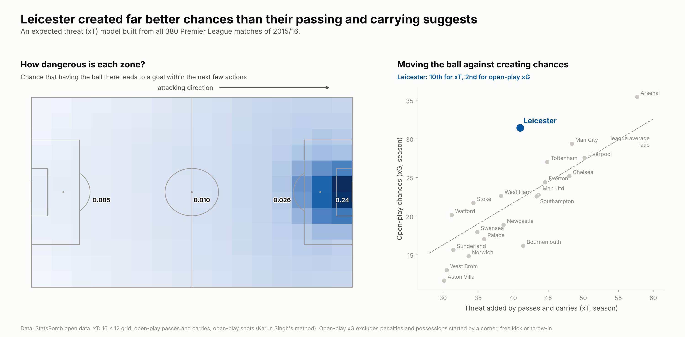
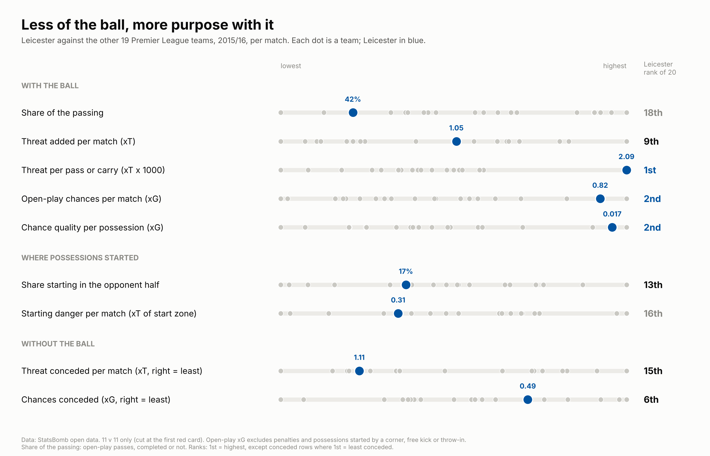
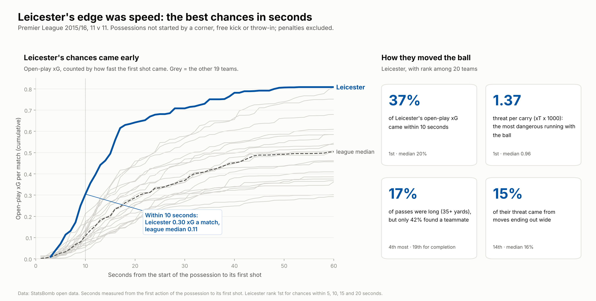
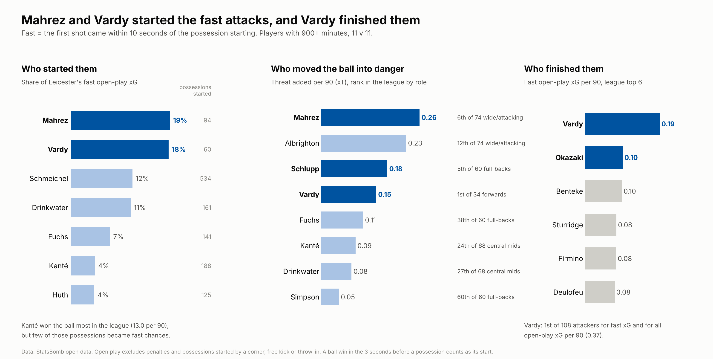

# How Leicester moved the ball: expected threat in the 2015/16 Premier League

Leicester won the 2015/16 Premier League with only 42% of the passing in their matches, 18th of 20. This project builds an **expected threat (xT)** model from all 380 matches of that season to ask how a team with so little of the ball still created the second-best chances in the league.

It follows on from [statsbomb-champions-2015-16](https://github.com/rafizrayhan/statsbomb-champions-2015-16), which showed that Leicester scored quickly. This project shows how.



## Key findings

**1. Leicester created far better chances than their passing and carrying suggests.** By the threat added by their passes and carries, they were mid-table (9th to 10th). By the quality of their open-play chances, they were 2nd, behind only Arsenal. No team turned ball progression into chances so efficiently: 0.77 open-play xG per unit of xT, against 0.65 for the next team (Watford) and a league average of 0.53.

**2. Less of the ball, more purpose with it.** Each Leicester pass or carry added more threat than any other team's (2.09 xT per thousand actions, 23% ahead of Southampton in 2nd). They also let opponents move the ball against them (15th for threat conceded) without letting them create (6th fewest chances conceded).



**3. Not because they won the ball higher up.** Leicester were 13th for possessions starting in the opponent half and 16th for the danger of their starting zones. The extra chance quality did not come from where they won the ball.

**4. Their edge was speed.** Leicester created 0.30 open-play xG a match from shots within 10 seconds of the possession starting: 1st in the league, almost three times the median (0.11) and 43% ahead of the next team. 37% of their open-play xG came that quickly (median 20%). They were 1st at 5, 10, 15 and 20 seconds. xT values a zone the same whether a defence is set or caught out, which is why it missed Leicester's main weapon.

They led on both how often and how well: 1.66 fast attacks a match (1st; median 0.93) and 0.18 xG per fast attack (2nd, behind Arsenal's 0.20 from far fewer). Liverpool broke almost as often (1.63) but created much weaker chances (0.13 each). A typical Leicester fast attack had **one pass**, and there were more carries than passes in them (124 against 104). The links that repeated all ended with Vardy: Drinkwater to Vardy (9), Mahrez to Vardy (7), Vardy to Okazaki (6), Albrighton to Vardy (5). Those counts are too small for a reliable passing network, so they are reported as counts only.

**5. Carries more than long balls.** Leicester's carries were the most dangerous in the league (1st for threat per carry). They played many long balls (4th) but completed only 42% (19th), so long balls were not their main source of threat (15th). They progressed through the middle and half-spaces, not out wide (14th for threat from moves ending in the wide channels).



**6. Mahrez and Vardy started the fast attacks, and Vardy finished them.** Possessions started by Mahrez (19%) and Vardy (18%) produced 37% of Leicester's fast open-play xG. Vardy was 1st of 108 forwards, attacking midfielders and wingers for fast open-play xG per 90 (0.19, twice anyone outside Leicester) and for all open-play xG per 90; Okazaki was 2nd for fast xG. Mahrez was 6th of 74 wide and attacking players for threat added per 90, and Schlupp 5th of 60 full-backs.

**7. Kanté won the ball back; he did not start the breaks.** Kanté made the most ball wins in the league (13.0 per 90, 1st of 320 players with 900+ minutes), but the possessions he started produced only 4% of Leicester's fast xG.



## Method

**Data.** StatsBomb open data, Premier League 2015/16, all 380 matches. Each match is reduced to the fields this project uses (`data/actions.csv.gz`); the raw files are not kept. Every score is rebuilt from the events (380 of 380 match).

**The xT model (part 1).** Karun Singh's method on a 16 x 12 grid. For each zone, from every open-play action starting there: the share of actions that are shots, the share that are moves (open-play passes, completed or not, and carries), the goal rate of open-play shots, and where completed moves end up. Solving xT(zone) = shot share x goal rate + move share x (expected xT of where the ball goes next) gives the chance that having the ball in a zone leads to a goal within the next few actions. Each completed pass or carry is worth xT(end zone) - xT(start zone). Failed passes get 0, as their risk is already priced into the zone values. **Validation:** over the season, team xT correlates 0.84 with team non-penalty xG and 0.83 with non-penalty goals across the 20 teams.

**Rules for parts 2 to 4.**
- **11 v 11 only:** each match is cut at the first red card (55 matches had one).
- **Open-play chances:** xG excluding penalties and possessions started by a corner, free kick or throw-in.
- **Fast:** the first shot came within 10 seconds of the possession's first action.
- **Long ball:** an open-play pass of 35+ yards.
- **Wide channels:** within 18 yards of a touchline.
- **Possession start:** the first action of the team in possession. A ball win logged in the 3 seconds before the possession began counts as its start, because StatsBomb often records the ball win as the last event of the opponent's possession.
- **Players:** minutes from the starting XI and substitutions. Players with 900+ minutes are ranked within role groups (centre-backs, full-backs, central midfielders, attacking midfielders and wingers, forwards, goalkeepers) from their most common position.
- **Threat received:** xT added by passes a player received.
- **Ball wins:** successful recoveries, interceptions won and tackles won.

## Checks (`checks.py`, output in `results/checks.txt`)

- **Results:** 380 of 380 scores rebuilt exactly.
- **Model sensitivity:** Leicester's ranks (xT per match / xT per action / chances per unit of xT) are 9 / 1 / 1 with the main model, 10 / 1 / 1 with a 12 x 8 grid, 9 / 1 / 1 with a 24 x 16 grid, and 9 / 1 / 1 with the model trained on all four complete 2015/16 leagues (1,517 matches). Zone values from the Premier League-only and four-league models correlate at 0.998.
- **Speed threshold:** Leicester rank 1st for fast open-play xG at 5, 10, 15 and 20 seconds.
- **Game state:** fast open-play xG per 90 when the score was level: Leicester 0.27, 1st (median 0.10). When leading: 2nd. When trailing: 1st. Their speed was not just counter-attacking with a lead.
- **Match by match:** Leicester beat the median team's fast-xG rate in 26 of 38 matches; without their best three matches they still averaged 0.23 a match, more than twice the median.

## Limitations

- **xT only values moving the ball.** It does not credit runs without the ball (which is why Vardy is only 18th of 34 forwards for threat received, despite leading for chances), defensive pressure, or the state of the defence. That last gap is the project's main finding rather than a flaw in it, but the model alone would undervalue Leicester.
- **Crosses** can be valued generously by xT because they end in high-value zones.
- **Time on the ball is not used.** StatsBomb timestamps include dead-ball time, which stretched some possessions (Leicester's average possession lasted 20 seconds, the median 9), so possession is measured by share of the passing.
- **Role groups** come from StatsBomb's listed positions, which do not always match how a player played.
- **Small samples:** possession-start figures for players with few possessions are unstable (Demarai Gray: 1.0 fast xG from 4 possessions), so the chart shows only players with 20+ possessions started.

## Run it

```bash
pip install -r requirements.txt
./run_all.sh
```

`part0_data.py` downloads the 380 matches once (a few minutes) and keeps a compact table in `data/`. `checks.py` also downloads La Liga, Serie A and Ligue 1 2015/16 for the four-league model and keeps only their passes, carries and shots.

| Script | What it does | Output |
|---|---|---|
| `common.py` | download, compact event table, name cleaning | |
| `part0_data.py` | data, score audit, league table | `data/*`, `results/league_table.csv` |
| `part1_xt.py` | builds the xT model, values every pass and carry, validation | `results/xt_grid.csv`, `results/moves_xt.csv.gz` |
| `part1b_chart.py` | danger map, xT against chances | `figures/part1_xt_model.png`, `results/team_xt_vs_xg.csv` |
| `part2_league.py` | Leicester against the league | `results/team_profile.csv`, `results/possessions.csv.gz` |
| `part2b_chart.py` | part 2 chart | `figures/part2_league.png` |
| `part3_how.py` | passes and carries, speed, long balls, zones | `results/how_profile.csv` |
| `part3b_chart.py` | speed curve and tiles | `figures/part3_how.png`, `results/speed_curve.csv` |
| `part3c_fast_attacks.py` | inside the fast attacks: how many, how good, passes and carries, repeated links | `results/fast_attacks_teams.csv`, `results/fast_attack_links.csv` |
| `part4_players.py` | player threat, ball wins, who started and finished fast attacks | `results/players.csv`, `results/leicester_starters.csv`, `results/fast_shooters.csv` |
| `part4b_chart.py` | part 4 chart | `figures/part4_players.png` |
| `checks.py` | all checks above | `results/checks.txt` |

---

Data: [StatsBomb open data](https://github.com/statsbomb/open-data). xT method: Karun Singh, "Introducing Expected Threat (xT)" (2018). Analysis by Rafiz Rayhan ([GitHub](https://github.com/rafizrayhan), [LinkedIn](https://www.linkedin.com/in/rafiz-rayhan)).
